# Intersection Risk Evaluation Based on LiDAR Data

Roadside LiDAR detection & tracking → surrogate safety metrics (**TTC**, **PET**) for near-miss / conflict analysis.

This README summarizes the case-study presentation (methodology + results). Site names and street addresses are anonymized as **Site A / B / C**.

---

## Motivation

Surrogate safety measures help identify potential safety issues **without waiting for crashes**. From LiDAR-based vehicle detection and tracking we recover near-crash events and learn **where** and **how** traffic conflicts occur.

---

## Safety Metrics

### Time to Collision (TTC)

TTC measures the time remaining before two road users would collide if they continued at their current speeds and trajectories.

- A **smaller TTC** → higher rear-end collision risk  
- **TTC &lt; 2 s** → critical rear-end conflict (threshold used in this study)

TTC characterizes **longitudinal / following** risk.

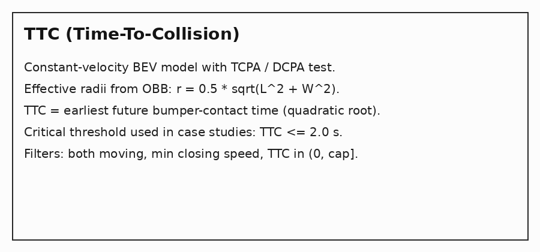

### Post-Encroachment Time (PET)

PET measures the time gap between two road users passing through the **same potential conflict area**.

- A **smaller PET** → closer interaction; higher crossing / merging / diverging risk  
- **PET ≤ 2 s** → critical conflict (threshold used in this study)

PET characterizes **lateral / crossing** risk. Together, TTC and PET cover complementary conflict types.

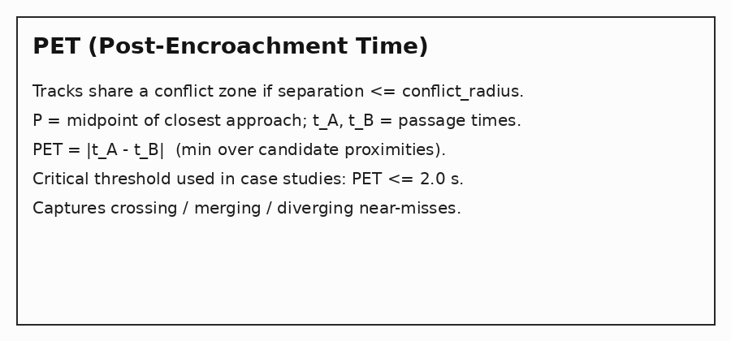

---

## Data Collection

| Site | Type | Duration | Sensor |
|------|------|----------|--------|
| **Site A** | Signalized intersection | ~30 min | 64-channel roadside LiDAR |
| **Site B** | Signalized intersection | ~30 min | 64-channel roadside LiDAR |
| **Site C** | Railroad-crossing corridor | ~30 min | 64-channel roadside LiDAR |

Perception pipeline used for the case studies:

```
Point cloud → ROI crop → ground removal → DBSCAN → OBB classify
          → background filter → Kalman + Hungarian tracker
          → TTC / PET / near-miss reports + heatmaps
```

Code layout: `detection/` (detect + track), `conflict_analysis/scripts/` (TTC/PET/viz).

---

## Case Study — Site A

### LiDAR detection & tracking

Point cloud (BEV) and tracked vehicles (green OBBs + trajectories) inside the ROI polygon.

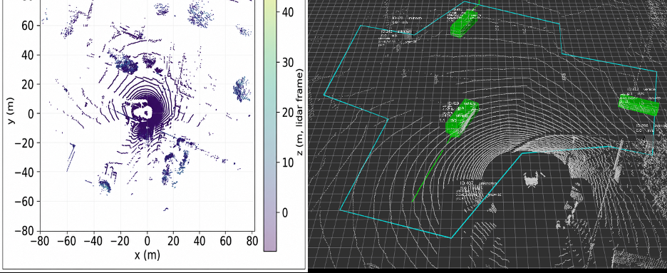

### TTC results

- **59** follower–leader pairs with positive TTC  
- Range **[0.20 s, 14.33 s]**, mean **2.64 s**  
- Critical (**TTC ≤ 2.0 s**): **21 / 59 (35.6%)**

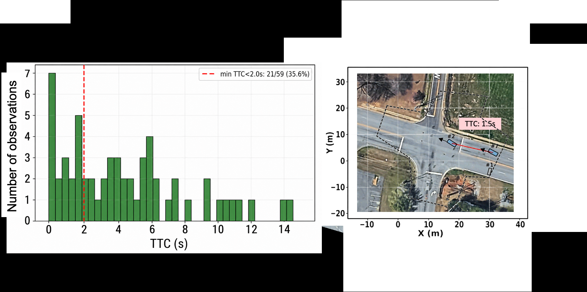

### PET results

- **125** vehicle pairs  
- Range **[0.80 s, 9.90 s]**, mean **3.69 s**  
- Critical (**PET ≤ 2.0 s**): **21 / 125 (16.8%)**  
- Example: right-turn (blue) vs through (red) with **PET ≈ 1.2 s** (merging conflict)

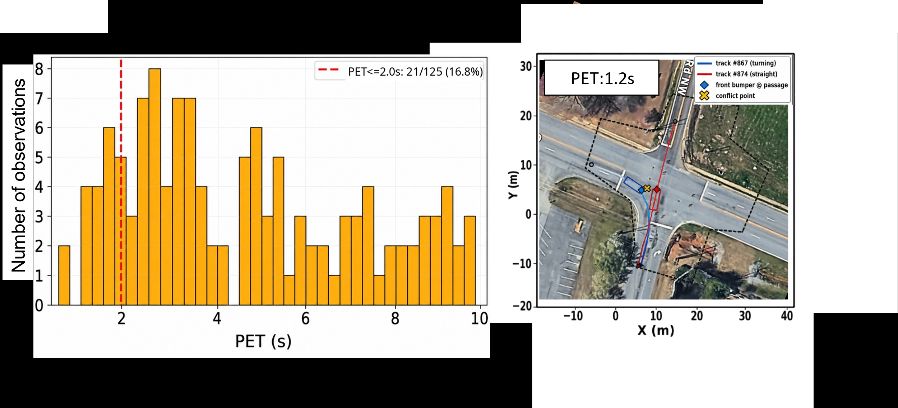

### PET conflict heatmap

Darker colors = higher accumulated conflict intensity, concentrated at crossing / merging areas.

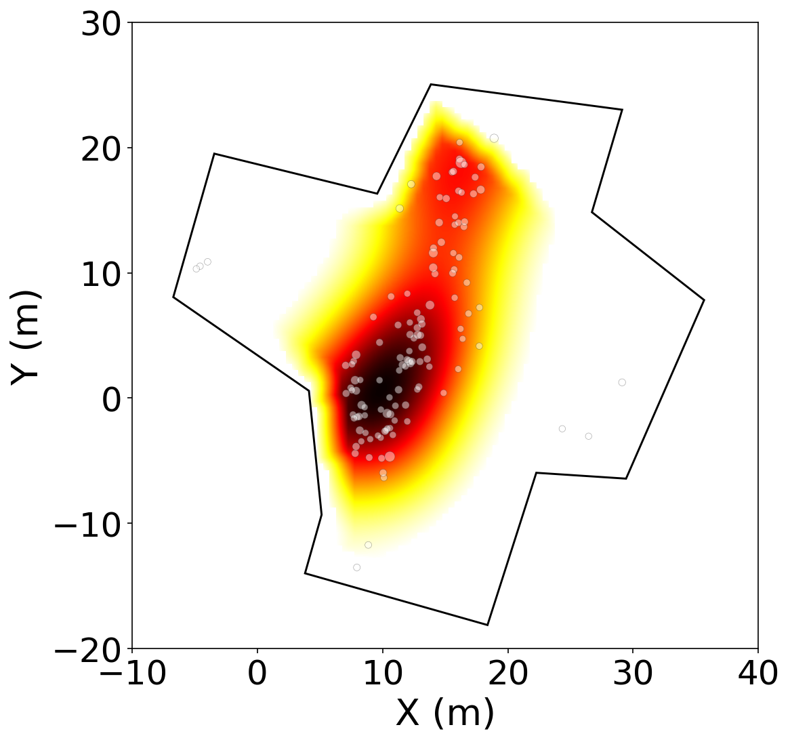

---

## Case Study — Site B

### LiDAR detection & tracking

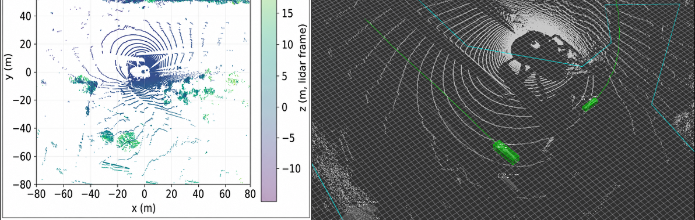

### TTC results

- **681** follower–leader pairs with positive TTC  
- Range **[0.20 s, 14.68 s]**, mean **3.84 s**  
- Critical (**TTC ≤ 2.0 s**): **265 / 681 (38.9%)** — **highest critical TTC rate** among the three sites  
- Example rear-end conflict with **TTC ≈ 1.28 s**

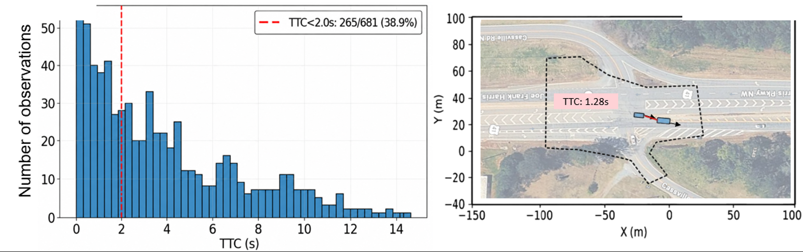

### PET results

- **55** vehicle pairs  
- Range **[0.20 s, 10.90 s]**, mean **4.13 s**  
- Critical (**PET ≤ 2.0 s**): **16 / 55 (29.1%)**  
- Example: left-turn vs through diverging conflict with **PET ≈ 1.2 s**

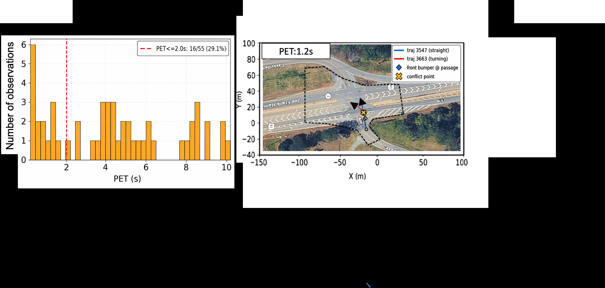

### PET conflict heatmap

Hotspots near the intersection center / approach, driven by crossing maneuvers with insufficient temporal separation.

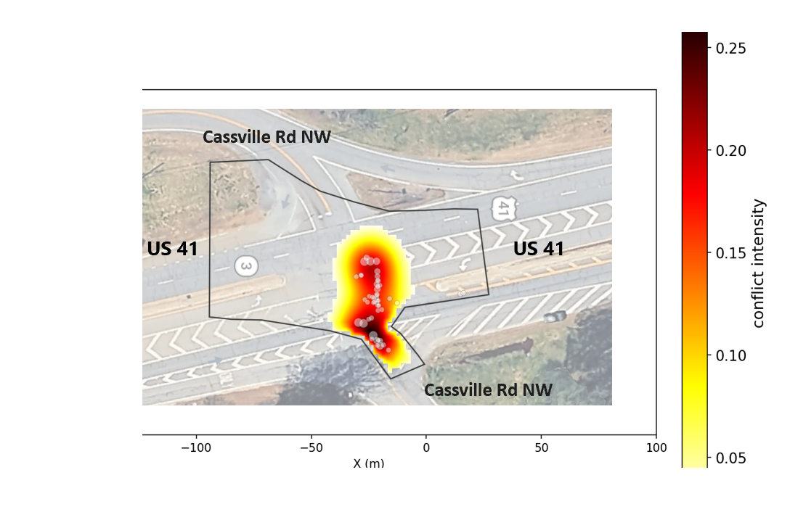

---

## Case Study — Site C (Railroad-Crossing Corridor)

### LiDAR detection & tracking

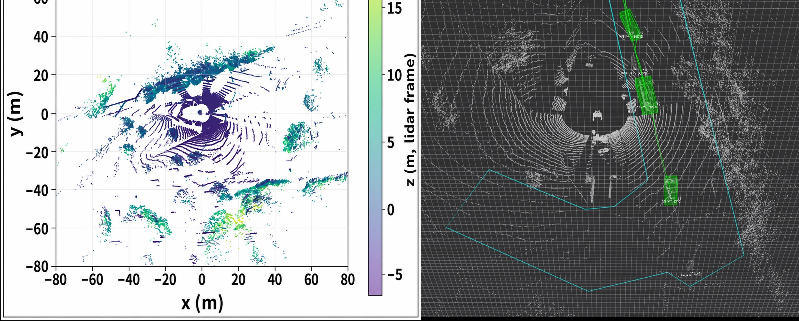

### TTC results

- **1,380** follower–leader pairs with positive TTC  
- Range **[0.20 s, 14.96 s]**, mean **4.80 s**  
- Critical (**TTC ≤ 2.0 s**): **309 / 1,380 (22.4%)**  
- Example: rear-end conflict after vehicles exit a constrained tunnel / bridge section

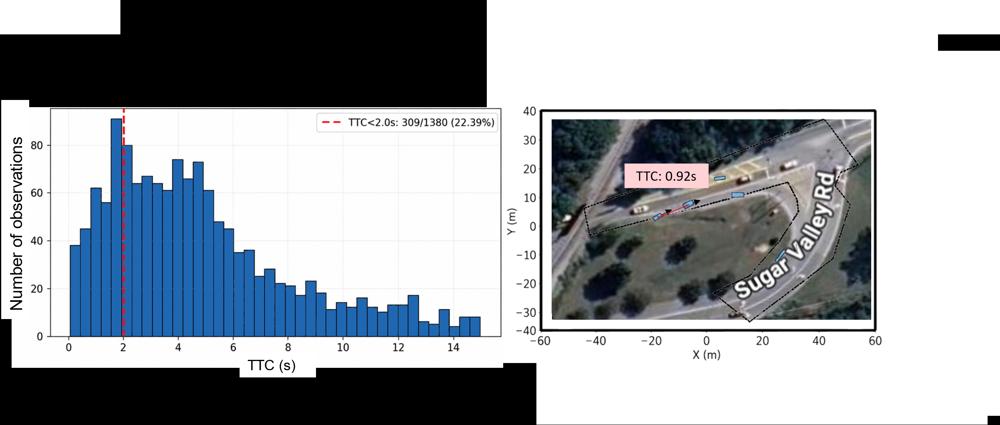

### PET results

- **91** vehicle pairs (canonical export)  
- Range **[0.30 s, 9.50 s]**, mean **4.01 s**  
- Critical (**PET ≤ 2.0 s**): **12 / 91 (13.2%)**  
- Example: diverging conflict in the **one-to-two-lane transition** downstream of the bridge (**PET ≈ 1.2 s**)

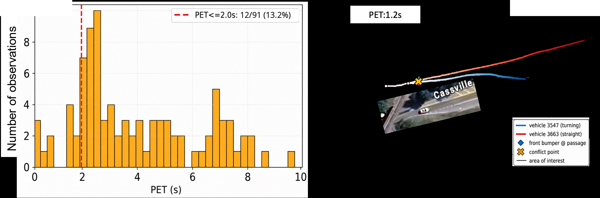

### PET conflict heatmap

Besides the typical junction conflict area, the **one-to-two-lane transition zone** also shows elevated conflict intensity.

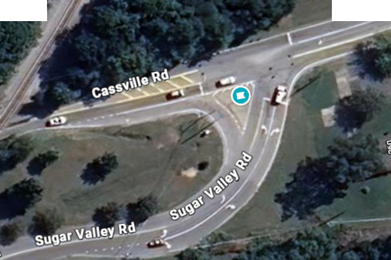

**Future work:** place sensors closer to the constrained bridge / tunnel to better capture lateral interactions with walls, opposing traffic, pedestrians, and lane-borrowing behavior.

---

## Summary Table

| Site | TTC critical ≤2 s | TTC mean | PET critical ≤2 s | PET mean |
|------|-------------------|----------|-------------------|----------|
| Site A | 21/59 (**35.6%**) | 2.64 s | 21/125 (**16.8%**) | 3.69 s |
| Site B | 265/681 (**38.9%**) | 3.84 s | 16/55 (**29.1%**) | 4.13 s |
| Site C | 309/1380 (**22.4%**) | 4.80 s | 12/91 (**13.2%**) | 4.01 s |

Numeric JSON: `docs/figures/site_*/case_summary.json`.

---

## How to Run

```bash
pip install -r requirements.txt

# Full offline pipeline on a rosbag2 directory
export BAG=<path-to-rosbag2>
bash conflict_analysis/scripts/run_full_pipeline.sh          # Site A defaults
# bash conflict_analysis/scripts/run_full_pipeline_session_b.sh
# bash conflict_analysis/scripts/run_full_pipeline_session_c.sh
```

Step-by-step:

```bash
python3 conflict_analysis/scripts/record_tracks.py --bag "$BAG" --n-frames -1
python3 conflict_analysis/scripts/evaluate_ttc.py --danger-ttc 2.0
python3 conflict_analysis/scripts/evaluate_pet.py --danger-pet 2.0
python3 conflict_analysis/scripts/summarize_nearmiss.py
python3 conflict_analysis/scripts/visualize_conflicts.py
```

Optional live ROS 2 node: see `detection/` (`detection_node`, launch + RViz configs).

---

## Repository Structure

```
detection/                   # ROS 2 Python package: ROI / DBSCAN / Kalman MOT
conflict_analysis/scripts/   # TTC, PET, near-miss, heatmaps
tools/roi/                   # ROI picking & offline helpers
dl_benchmark/                # Optional DL-based TTC evaluation helpers
docs/figures/                # Anonymized case-study figures
```

Raw bags and model checkpoints are not included (see `.gitignore`).
